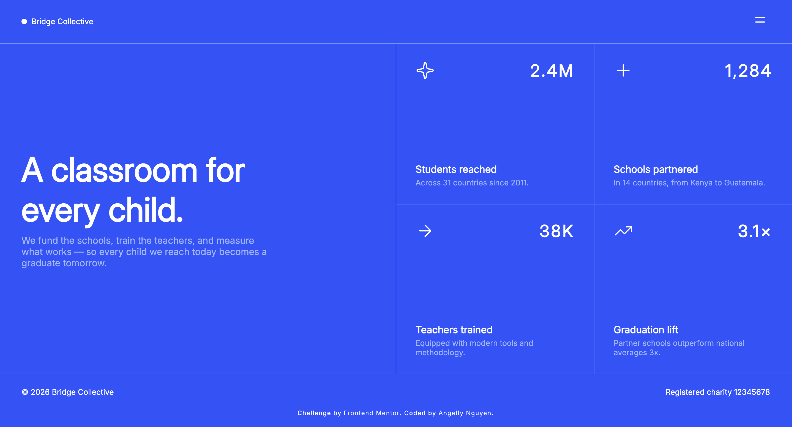
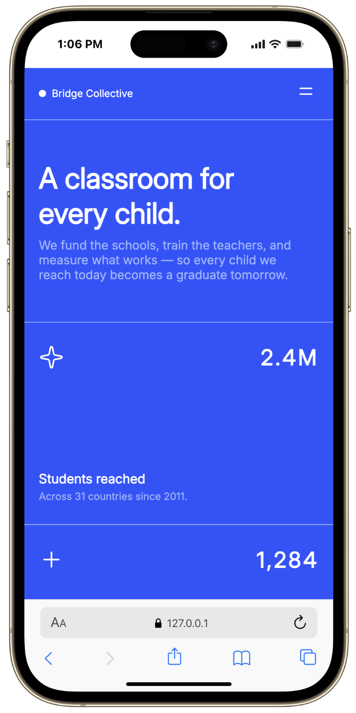

# Frontend Mentor - Grid landing page solution

This is my solution to the [Grid landing page challenge on Frontend Mentor](https://www.frontendmentor.io/challenges/grid-landing-page). The goal was to build a responsive landing page that matches the provided design while using modern HTML and CSS layout techniques.

## Table of contents

- [Overview](#overview)
  - [The challenge](#the-challenge)
  - [Screenshot](#screenshot)
  - [Links](#links)
- [My process](#my-process)
  - [Built with](#built-with)
  - [What I learned](#what-i-learned)
  - [Continued development](#continued-development)
  - [Useful resources](#useful-resources)
  - [AI Collaboration](#ai-collaboration)
- [Author](#author)
- [Acknowledgments](#acknowledgments)

## Overview

### The challenge

Build a landing page with:

- a branded header and hamburger menu
- a large hero section with bold typography
- a responsive stats grid
- a menu overlay that opens from the navigation toggle
- a clean footer and attribution bar

Users should be able to:

- view the layout optimally across desktop and mobile screen sizes
- understand the hierarchy of the page content quickly
- open and close the menu from the hamburger button
- see a polished, modern design close to the provided mockup

### Screenshot

Desktop preview:

Mobile preview:

### Links

- Solution URL: [GitHub Repository](https://github.com/kyduyennguyen/frontendmentor/tree/main/grid-landing-page-main)
- Live Site URL: [Grid Landing Page Demo](https://kyduyennguyen.github.io/frontendmentor/grid-landing-page-main/index.html)

## My process

### Built with

- Semantic HTML5 markup
- CSS custom properties
- CSS Grid
- Flexbox
- Responsive design
- Mobile-first workflow
- Google Fonts

### What I learned

This project helped me get more comfortable building a page layout with CSS Grid while still keeping the structure readable and maintainable. I also improved my understanding of how to create a navigation overlay that feels natural on a landing page and how to manage spacing, borders, and typography to match a design reference.

Working on this challenge also reinforced the importance of:

- structuring semantic content correctly
- using grid containers to align sections with consistent spacing
- keeping hover and interactive states simple but polished
- testing layout behavior at different widths

### Continued development

In future projects, I want to improve:

- the smooth animation of the menu transition
- responsive behavior for smaller breakpoints
- alignment and spacing to match design specs even more closely
- accessibility improvements such as keyboard focus states

### Useful resources

- [Frontend Mentor](https://www.frontendmentor.io)
- [MDN Web Docs: CSS Grid](https://developer.mozilla.org/en-US/docs/Web/CSS/CSS_Grid_Layout)
- [MDN Web Docs: Flexbox](https://developer.mozilla.org/en-US/docs/Web/CSS/CSS_Flexible_Box_Layout)
- [Google Fonts](https://fonts.google.com/)

### AI Collaboration

I used GitHub Copilot during this project to help review the HTML structure, suggest CSS refinements, and troubleshoot layout issues such as the menu overlay and spacing. It helped speed up the process and gave useful suggestions for organizing the code, while I still verified the final design and code manually.

## Author

- GitHub - [Angelly Nguyen](https://github.com/kyduyennguyen)
- Frontend Mentor - [@kyduyennguyen](https://www.frontendmentor.io/profile/kyduyennguyen)
- LinkedIn - [Duyen Nguyen](https://www.linkedin.com/in/duyen-dk-nguyen/)

## Acknowledgments

- Thanks to Frontend Mentor for providing the design challenge and inspiration.
- Thanks to the broader Frontend Mentor community for examples and practical learning resources.
