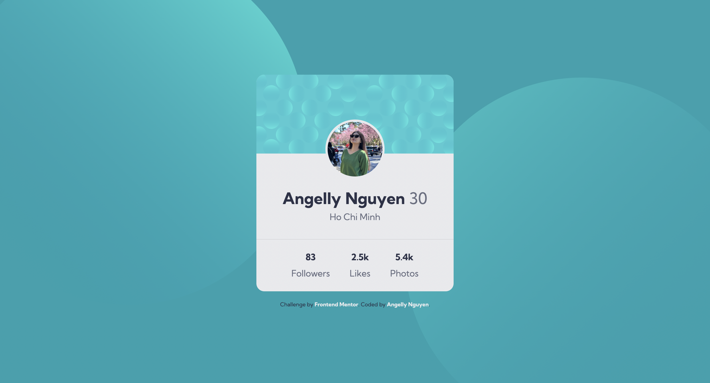
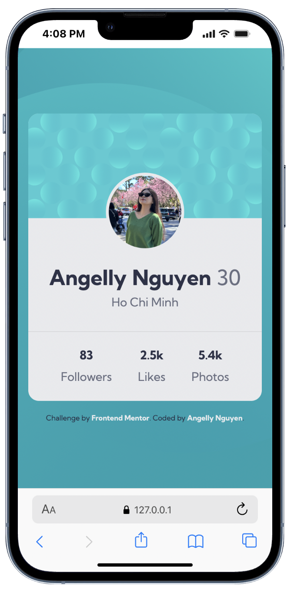

# Frontend Mentor - Profile card component solution

This is a solution to the [Profile card component challenge on Frontend Mentor](https://www.frontendmentor.io/challenges/profile-card-component-cfArpWshJ).

## Table of contents

- [Overview](#overview)
  - [The challenge](#the-challenge)
  - [Screenshot](#screenshot)
  - [Links](#links)
- [My process](#my-process)
  - [Built with](#built-with)
  - [What I learned](#what-i-learned)
  - [Continued development](#continued-development)
  - [Useful resources](#useful-resources)
  - [AI Collaboration](#ai-collaboration)
- [Author](#author)
- [Acknowledgments](#acknowledgments)

## Overview

### The challenge

Build out the profile card component and make it match the design as closely as possible. The page includes:

- a background with decorative pattern circles
- a centered card layout
- an avatar overlapping the top banner
- a profile name and location
- a stats row with follower, likes, and photos counts
- accessibility-friendly semantic HTML structure

### Screenshot

Desktop preview:



Mobile preview:



> These screenshots were captured directly from the completed design and stored in the screenshots folder.

### Links

- Solution URL: [GitHub repository](https://github.com/kyduyennguyen/frontendmentor/tree/main/profile-card-component-main)
- Live Site URL: [Open local project](https://kyduyennguyen.github.io/frontendmentor/profile-card-component-main/index.html)

## My process

### Built with

- Semantic HTML5 markup
- CSS custom properties
- Flexbox
- Responsive layout
- Google Fonts: Kumbh Sans

### What I learned

This challenge helped me improve my understanding of:

- positioning an avatar over a banner using absolute positioning
- centering a card layout with Flexbox
- working with layered backgrounds and decorative SVG patterns
- creating clean semantic structure with `main`, `header`, `article`, `section`, and `footer`
- matching a design using spacing, typography, and color consistency

Example of a key layout pattern used:

```css
body {
  min-height: 100vh;
  display: flex;
  justify-content: center;
  align-items: center;
}
```

### Continued development

In future projects, I want to continue improving:

- responsive design patterns for mobile and desktop
- more precise pixel-matching with design references
- accessibility and semantic HTML best practices
- using CSS variables and reusable design tokens more consistently

### Useful resources

- [Kumbh Sans on Google Fonts](https://fonts.google.com/specimen/Kumbh+Sans)
- [MDN Flexbox Guide](https://developer.mozilla.org/en-US/docs/Web/CSS/CSS_Flexible_Box_Layout/Basic_Concepts_of_Flexbox)
- [Frontend Mentor](https://www.frontendmentor.io/)

### AI Collaboration

I used GitHub Copilot to help review the HTML structure, debug CSS layout issues, and refine the visual spacing to better match the design reference.

- Tool used: GitHub Copilot
- How it helped: reviewing layout logic, suggesting CSS fixes, and checking semantic HTML structure
- What worked well: quick iteration on spacing and positioning
- What still needs practice: fine-tuning exact pixel matching and typography detail

## Author

- GitHub - [Angelly Nguyen](https://github.com/kyduyennguyen)
- Frontend Mentor - [@kyduyennguyen](https://www.frontendmentor.io/profile/kyduyennguyen)

## Acknowledgments

Thanks to Frontend Mentor for providing the challenge and the design reference. This project was a good exercise in building a clean profile card layout with responsive, semantic HTML and CSS styling.
